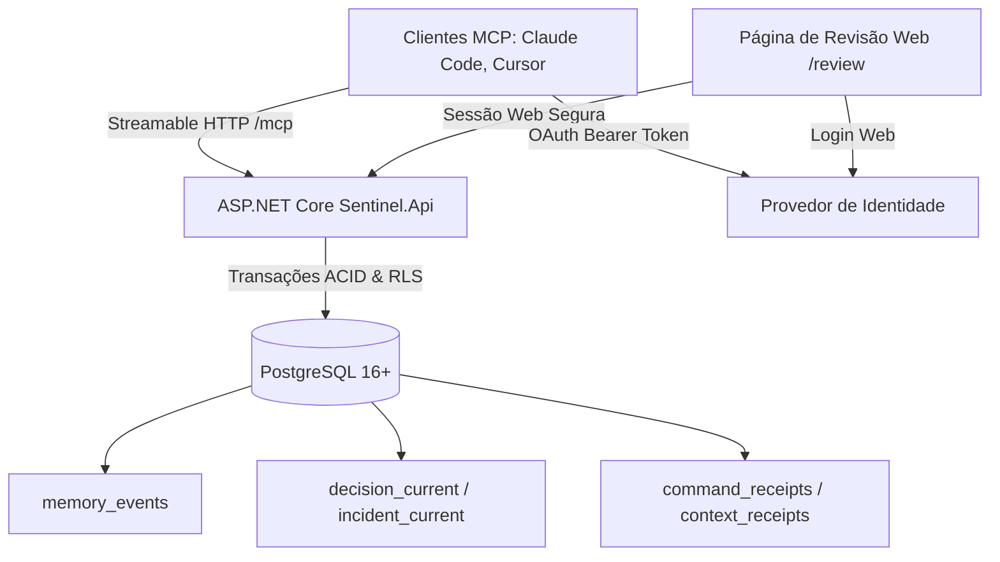

# Sentinel-MCP

> Servidor MCP de Memória de Engenharia, Decisões de Arquitetura (ADRs) e Incidentes (RCAs) com consistência estrita, rastreabilidade e isolamento por workspace.

[](https://github.com/sentinel/sentinel-mcp/actions)
[](https://opensource.org/licenses/MIT)

## Visão Geral

O **Sentinel-MCP** conecta agentes de desenvolvimento de software (como Claude Code, Cursor, Copilot e agentes autônomos) à base de conhecimento corporativa de engenharia. Ele soluciona o problema de agentes proporem soluções repetidas já descartadas ou analisarem incidentes sem conhecer correções anteriores.

### Principais Capacidades
- **Contrato MCP Oficial**: Implementa as tools `propose_decision`, `log_incident`, `query_context`, `get_timeline` e `get_context_receipt` sobre Streamable HTTP.
- **Event Sourcing & Consistência Forte**: Cada decisão ou incidente gera eventos imutáveis com redutor determinístico e projeções de leitura síncronas.
- **Concorrência e Idempotência**: Controle por `expectedVersion` com detecção de `VERSION_CONFLICT` e recibos deduplicados por `idempotencyKey`.
- **Comprovantes de Consulta**: Rastreabilidade auditável das decisões exatas apresentadas ao agente, sem retenção de prompts ou dados sensíveis.
- **Governança Segura**: Nenhuma decisão é ativada automaticamente; a aprovação humana ocorre em interface web separada com CSRF e papel Maintainer.
- **Isolamento Multitenant**: Políticas de Row-Level Security (RLS) no PostgreSQL por workspace.

## Arquitetura



## Quick Start com Docker Compose

```bash
# Clone e entre no diretório
git clone https://github.com/sentinel/sentinel-mcp.git
cd sentinel-mcp

# Copie as configurações
cp .env.example .env

# Inicie o PostgreSQL e a API Sentinel
docker compose up -d

# Verifique o status
curl http://localhost:5000/healthz
```

Acesse a página de revisão web em: `http://localhost:5000/review`.

## Desenvolvimento Local (.NET 9 SDK)

```bash
# Restaurar e compilar
dotnet restore
dotnet build

# Executar testes unitários e de integração
dotnet test
```

## Tools MCP Disponíveis

| Tool | Finalidade | Permissão / Escopo |
| --- | --- | --- |
| `propose_decision` | Submeter uma proposta técnica de decisão para revisão | `write:decision` (Contributor/Maintainer) |
| `log_incident` | Registrar um incidente ocorrido com evidências técnicas | `write:incident` (Contributor/Maintainer) |
| `query_context` | Buscar decisões ativas e incidentes com comprovante | `read:memory` (Reader+) |
| `get_timeline` | Reconstituir o histórico e versões passadas de um fluxo | `read:memory` (Reader+) |
| `get_context_receipt` | Recuperar o comprovante auditável de uma consulta | `read:memory` (Autor/Membro do workspace) |

## Licença
MIT
