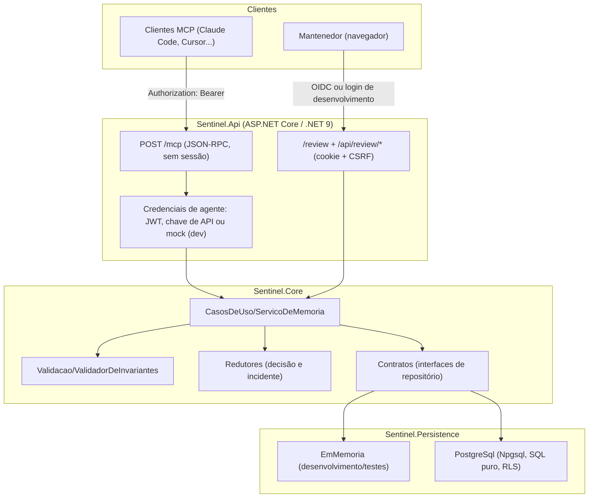

<p align="center">
  
</p>

<h1 align="center">Sentinel-MCP</h1>

<p align="center">
  <strong>A Memória da sua Engenharia</strong><br />
  Decisões técnicas e incidentes versionados como eventos imutáveis, consultados por agentes de IA via MCP e aprovados exclusivamente por pessoas.
</p>

<p align="center">
  
  
  
</p>

---

## Sumário

- [Visão geral](#visão-geral)
- [Arquitetura](#arquitetura)
- [Tools, Resources e Prompts MCP](#tools-resources-e-prompts-mcp)
- [Conectando clientes MCP](#conectando-clientes-mcp)
- [Execução local](#execução-local)
- [Configuração e segredos](#configuração-e-segredos)
- [Segurança](#segurança)
- [Operação](#operação)
- [Testes](#testes)
- [Critérios de aceite (AC-01 a AC-08)](#critérios-de-aceite-ac-01-a-ac-08)
- [Estrutura da solução](#estrutura-da-solução)
- [Limitações conhecidas e pendências](#limitações-conhecidas-e-pendências)
- [Documentação complementar](#documentação-complementar)
- [Licença](#licença)

---

## Visão geral

O **Sentinel-MCP** é um servidor MCP (*Model Context Protocol*) em C#/.NET 9 que dá a agentes de desenvolvimento (**OpenAI Codex**, **Claude Code**, **Cursor**, **Gemini CLI**, **VS Code Copilot** e outros clientes MCP) acesso às decisões arquiteturais vigentes e aos incidentes registrados de uma organização.

Problemas que ele ataca:

1. **Propostas recicladas**: um agente sugere uma abordagem que a equipe já avaliou e descartou.
2. **Incidentes sem histórico**: um agente analisa uma falha sem ver o RCA e a mitigação de um caso anterior.
3. **Conhecimento fragmentado**: decisões ficam espalhadas em PRs, chats e ADRs sem indicação de vigência.

Ciclo de governança:

```
┌─────────────────┐       propose_decision       ┌─────────────────────┐
│  Agente de IA   │ ───────────────────────────> │  Sentinel (MCP)     │
│  (cliente MCP)  │                              │  proposta pendente  │
└─────────────────┘                              └──────────┬──────────┘
                                                            │
                                                            ▼
┌─────────────────┐   aprovação / rejeição       ┌─────────────────────┐
│   Mantenedor    │ ───────────────────────────> │  /review            │
│   (pessoa)      │   sessão web + CSRF          │  (papel Maintainer) │
└─────────────────┘                              └──────────┬──────────┘
                                                            │
                                                            ▼
┌─────────────────┐        query_context         ┌─────────────────────┐
│  Outro agente   │ <─────────────────────────── │ Decisão vigente     │
│                 │  + comprovante (digest)      │ + incidentes        │
└─────────────────┘                              └─────────────────────┘
```

Garantias implementadas:

| Garantia | Como é implementada |
| --- | --- |
| **Histórico imutável** | Cada proposta, aprovação, rejeição, substituição e incidente é um evento em `memory_events` com payload em `memory_payloads`. No PostgreSQL, triggers impedem `UPDATE`, `DELETE` e `TRUNCATE` nessas tabelas. |
| **Projeções derivadas** | `decision_current`, `incident_current` e `decision_pending_proposals` são sempre calculadas pelo redutor (`RedutorDeDecisao` / `RedutorDeIncidente`) na mesma transação do evento. A reconstrução usa o mesmo redutor. |
| **Concorrência por tópico** | `expectedVersion` obrigatório; o tópico é travado (`FOR UPDATE`) e divergências retornam `VERSION_CONFLICT`. A primeira proposta usa `INSERT ... ON CONFLICT`. Só existe **uma proposta pendente por tópico**: nova proposta enquanto há pendente retorna `PROPOSAL_PENDING`. |
| **Idempotência** | Toda escrita exige `idempotencyKey`. Retentativas com os mesmos argumentos devolvem o resultado original; argumentos diferentes retornam `IDEMPOTENCY_KEY_REUSED`. No PostgreSQL, um lock consultivo por chave serializa retentativas concorrentes. |
| **Isolamento por workspace** | Vínculo ativo (`memberships`) verificado em cada caso de uso; sem vínculo a resposta é `NOT_FOUND`. No PostgreSQL, RLS com `FORCE ROW LEVEL SECURITY` e `app.current_workspace_id` definido por transação. |
| **Aprovação somente humana** | Nenhuma tool MCP aprova, rejeita ou restaura. Essas ações exigem sessão web, token CSRF e papel Maintainer. |
| **Comprovante de consulta** | Cada `query_context` grava os itens entregues (IDs e versões, em ordem) com um digest SHA-256 canônico. É um registro de integridade verificável pelo servidor, **não uma assinatura digital**. |

---

## Arquitetura



- **Uma única camada de casos de uso** (`src/Sentinel.Core/CasosDeUso/ServicoDeMemoria.cs`): validação de entrada (via `ValidadorDeInvariantes`), vínculo e papel no workspace e a regra de que aprovação/rejeição/restauração só aceitam o canal web. O endpoint MCP e a página de revisão apenas autenticam e traduzem.
- **Contratos de repositório** em `src/Sentinel.Core/Contratos`, com duas implementações: em memória e PostgreSQL.
- **Armazenamento**: `Sentinel:StorageProvider` = `InMemory` (padrão; não persiste, proibido em Production) ou `PostgreSQL`.

---

## Tools, Resources e Prompts MCP

### Ferramentas (`tools/list` / `tools/call`)

| Tool | Descrição | Exige |
| --- | --- | --- |
| `list_workspaces` | Descobre os workspaces, papel do agente e projetos acessíveis à credencial autenticada (`readOnlyHint: true`). | escopo `read:memory` + vínculo ativo |
| `propose_decision` | Registra uma proposta num tópico (`topicKey`), com justificativa e evidências HTTPS. Fica pendente até aprovação humana. | escopo `write:decision` + papel Contributor ou Maintainer |
| `log_incident` | Registra um incidente (`reported`) com chaves técnicas e evidências. | escopo `write:incident` + papel Contributor ou Maintainer |
| `query_context` | Busca decisões `active` e/ou incidentes `reported` e grava um comprovante. `kind`: `decision` (padrão), `incident` ou `both`; `limit` de 1 a 20 (padrão 10). | escopo `read:memory` + papel Reader ou superior |
| `get_timeline` | Reconstitui o estado de um fluxo numa versão (`atVersion`, padrão: atual) e lista eventos em ordem decrescente; `limit` de 1 a 50 (padrão 20); use `nextBeforeVersion` como `beforeVersion` para a próxima página. O estado reconstituído independe da página. | escopo `read:memory` + papel Reader ou superior |
| `get_context_receipt` | Devolve o comprovante de uma consulta: itens ordenados com versões, `digest`, `digestAlgorithm: "sha256"` e `integrityVerified` (o servidor recalcula o digest). | escopo `read:memory`; visível ao autor da consulta e a Maintainers do workspace (demais recebem `NOT_FOUND`) |

Todas as 6 ferramentas publicam `inputSchema`, `outputSchema` e `annotations`, retornam `structuredContent` e incluem o JSON completo dentro de `content[0].text` para clientes que consomem apenas texto.

### Resources & Prompts
- **Resources (`resources/list`, `resources/read`)**: `sentinel://workspaces`, `sentinel://guide`, além dos templates `sentinel://workspaces/{workspaceId}/projects/{projectId}/decisions` e `sentinel://workspaces/{workspaceId}/projects/{projectId}/incidents`.
- **Prompts (`prompts/list`, `prompts/get`)**: `consult_context_before_change`, `propose_architecture_decision` e `report_incident_rca`.

Erros de tool voltam com `isError: true` e `structuredContent.code` igual a um destes códigos: `VALIDATION_ERROR`, `NOT_FOUND`, `VERSION_CONFLICT`, `PROPOSAL_PENDING`, `IDEMPOTENCY_KEY_REUSED`, `FORBIDDEN`, `UNAUTHORIZED`, `TEMPORARILY_UNAVAILABLE`, `INTERNAL_ERROR`. Em `INTERNAL_ERROR` a mensagem é genérica e traz apenas um ID de correlação; o detalhe fica no log do servidor.

### Busca (`query_context`)

- Candidatos: `search_vector @@ websearch_to_tsquery('portuguese' | 'simple', query)`, chave técnica normalizada igual a uma das palavras da consulta ou à consulta inteira, ou `ILIKE` em título/resumo (com escape de `%` e `_`).
- Escopo: somente o workspace e o projeto informados; decisões com estado `active` e incidentes `reported`.
- Ordem determinística: correspondência exata de chave técnica, `ts_rank_cd`, data (desc.) e ID.
- `search_vector` e `technical_keys_norm` são colunas geradas com índice GIN (migração 003).

### Exemplo: `propose_decision`

IDs do conjunto de demonstração (`--seed-demo` / InMemory em Development): workspace `11111111-1111-1111-1111-111111111111`, projeto `aaaaaaaa-aaaa-aaaa-aaaa-aaaaaaaaaaaa`.

```json
{
  "jsonrpc": "2.0",
  "id": 1,
  "method": "tools/call",
  "params": {
    "name": "propose_decision",
    "arguments": {
      "workspaceId": "11111111-1111-1111-1111-111111111111",
      "projectId": "aaaaaaaa-aaaa-aaaa-aaaa-aaaaaaaaaaaa",
      "topicKey": "pix-idempotency",
      "expectedVersion": 0,
      "title": "Chave de idempotência obrigatória na cobrança Pix",
      "summary": "Toda criação de cobrança Pix deve enviar X-Idempotency-Key com retenção mínima de 24 horas.",
      "rationale": "Evita cobranças duplicadas em retentativas incertas do gateway.",
      "technicalKeys": ["pix", "idempotency", "billing"],
      "evidence": [
        { "type": "adr", "label": "ADR de idempotência de pagamentos", "url": "https://example.com/adr/003-payment-idempotency" }
      ],
      "idempotencyKey": "prop-pix-idem-001"
    }
  }
}
```

`expectedVersion` é `0` para um tópico novo; para um tópico existente, informe a versão atual do fluxo (obtida, por exemplo, com `get_timeline`).

### Exemplo: `query_context`

```json
{
  "jsonrpc": "2.0",
  "id": 2,
  "method": "tools/call",
  "params": {
    "name": "query_context",
    "arguments": {
      "workspaceId": "11111111-1111-1111-1111-111111111111",
      "projectId": "aaaaaaaa-aaaa-aaaa-aaaa-aaaaaaaaaaaa",
      "query": "idempotency",
      "kind": "both",
      "limit": 5
    }
  }
}
```

A resposta traz `queryId`, `matchStatus` (`found` ou `none`), `searchMode` (`textual`) e `items` com IDs, versões, estado, resumo e evidências. O `queryId` pode ser usado depois em `get_context_receipt`. O comprovante não guarda o texto da consulta.

---

## Conectando clientes MCP

O Sentinel-MCP oferece três modos de transporte compatíveis com qualquer cliente MCP (`2025-11-25`, `2025-06-18`, `2025-03-26`, `2024-11-05`):
- **`POST /mcp`** — Streamable HTTP stateless JSON-RPC (recomendado).
- **`/mcp/sse`** — Endpoint HTTP stateful via SDK oficial `ModelContextProtocol.AspNetCore`.
- **`--stdio`** — Transporte local via CLI (`dotnet run --no-build --project src/Sentinel.Api -- --stdio`).

**Toda requisição HTTP precisa de `Authorization: Bearer <token>`**; veja em [Credenciais de agente](#credenciais-de-agente) quais tokens são aceitos. Em desenvolvimento, use um token mock, por exemplo `mock:agent-dev-1|read:memory,write:decision,write:incident|codex`. Veja o guia completo em [docs/guides/conectando-agentes-mcp.md](docs/guides/conectando-agentes-mcp.md).

### OpenAI Codex (`codex-cli` e Extensão VS Code)

Via CLI com HTTP:
```powershell
$env:SENTINEL_MCP_TOKEN = "mock:agent-dev-1|read:memory,write:decision,write:incident|codex"
codex mcp add sentinel --url http://localhost:5000/mcp --bearer-token-env-var SENTINEL_MCP_TOKEN
```

No Windows/VS Code (ou quando a extensão não herda variáveis do terminal), prefira declarar o header explícito em `~/.codex/config.toml` (`%USERPROFILE%\.codex\config.toml`):
```toml
[mcp_servers.sentinel]
url = "http://localhost:5000/mcp"

[mcp_servers.sentinel.http_headers]
Authorization = "Bearer mock:agent-dev-1|read:memory,write:decision,write:incident|codex"
```

Ou via **STDIO** no `~/.codex/config.toml` (sem depender de porta HTTP):
```toml
[mcp_servers.sentinel]
command = "dotnet"
args = ["run", "--no-build", "--no-launch-profile", "--project", "./src/Sentinel.Api", "--", "--stdio", "--token", "mock:agent-dev-1|read:memory,write:decision,write:incident|codex"]

[mcp_servers.sentinel.env]
ASPNETCORE_ENVIRONMENT = "Development"
```

### Claude Code

```bash
claude mcp add --transport http sentinel http://localhost:5000/mcp --header "Authorization: Bearer <token>"
```

### Cursor

Em `.cursor/mcp.json`:

```json
{
  "mcpServers": {
    "sentinel": {
      "url": "http://localhost:5000/mcp",
      "headers": {
        "Authorization": "Bearer <token>"
      }
    }
  }
}
```

### Gemini CLI e VS Code Copilot

- **Gemini CLI** (`~/.gemini/settings.json`): configure `httpUrl: "http://localhost:5000/mcp"` e `headers.Authorization`.
- **VS Code** (`.vscode/mcp.json`): configure `type: "http"`, `url: "http://localhost:5000/mcp"` e `headers.Authorization` com `input` seguro.

Exemplos completos e diagnóstico em [docs/guides/conectando-agentes-mcp.md](docs/guides/conectando-agentes-mcp.md).

Não versione arquivos com tokens reais. O servidor não implementa fluxo OAuth próprio: quando JWT está configurado, o cliente obtém o token no provedor de identidade e o envia no cabeçalho.

---

## Execução local

Pré-requisitos: .NET 9 SDK (ou .NET 10 com roll-forward); Docker (para o compose e para os testes de PostgreSQL).

> **Ambiente:** em uso direto via `dotnet run` sem perfil de launch (`--no-launch-profile`) ou binário publicado, o ambiente padrão do ASP.NET Core é **Production**, que exige PostgreSQL (`ConnectionStrings:Database`). No repositório há `src/Sentinel.Api/Properties/launchSettings.json` definindo `ASPNETCORE_ENVIRONMENT=Development` e `http://localhost:5000`, mas exportar a variável explicitamente garante previsibilidade em qualquer shell.

### Opção 1: InMemory (Development)

`appsettings.Development.json` já habilita: armazenamento InMemory com dados de demonstração, tokens mock (`Sentinel:AllowMockTokens`) e login de desenvolvimento (`Sentinel:Web:EnableDevLogin`).

```bash
# bash
ASPNETCORE_ENVIRONMENT=Development dotnet run --project src/Sentinel.Api
```

```powershell
# PowerShell
$env:ASPNETCORE_ENVIRONMENT = "Development"
dotnet run --project src/Sentinel.Api
```

A API escuta em `http://localhost:5000`. Os dados somem ao encerrar o processo.

- Landing: `http://localhost:5000/`
- Revisão: `http://localhost:5000/review` → redireciona para `/auth/login`. Informe o sujeito `maintainer-alice` (Maintainer). Também existem `reader-bob` (Reader) e `agent-dev-1` (Contributor) no workspace de demonstração.
- Agente (token mock): `mock:agent-dev-1|read:memory,write:decision,write:incident|meu-cliente`.

Formato do token mock: `mock:sujeito|escopo1,escopo2|clientId|emissor`. Campos após o sujeito são opcionais (sem escopos, todos são concedidos; emissor padrão `https://auth.sentinel.dev`, o mesmo das fixtures). O papel vem do vínculo do sujeito no workspace, não do token.

Smoke test:

```bash
curl http://localhost:5000/healthz
curl -X POST http://localhost:5000/mcp \
  -H "Content-Type: application/json" \
  -H "Authorization: Bearer mock:agent-dev-1|read:memory|smoke" \
  -d '{"jsonrpc":"2.0","id":1,"method":"initialize","params":{"protocolVersion":"2025-06-18","capabilities":{},"clientInfo":{"name":"smoke","version":"1.0"}}}'
```

### Opção 2: Docker Compose com PostgreSQL

```bash
cp .env.example .env          # defina POSTGRES_PASSWORD e SENTINEL_APP_DB_PASSWORD
docker compose up -d --build
curl http://localhost:5000/readyz
```

Serviços:

| Serviço | Função |
| --- | --- |
| `postgres` | PostgreSQL. Na **primeira** inicialização do volume, `db/docker/01-create-app-role.sh` cria o papel `sentinel_app` (NOLOGIN, sem BYPASSRLS) e o login `sentinel_app_login` com a senha do `.env`. |
| `sentinel-migrate` | Execução única de `--migrate` usando o superusuário (`ConnectionStrings__DatabaseAdmin`). |
| `sentinel-api` | API conectada como `sentinel_app_login` (sujeita a RLS). Sobe só depois que `sentinel-migrate` termina com sucesso. |

- As portas ficam presas em `127.0.0.1` (5000 e 5432).
- `ASPNETCORE_ENVIRONMENT` padrão no compose é `Development` (tokens mock e login de desenvolvimento ativos). Altere no `.env` para outros cenários.
- O banco sobe **vazio** (sem workspaces). Para carregar os dados de demonstração:

```bash
docker compose exec -T postgres psql -U postgres -d sentinel_mcp -v ON_ERROR_STOP=1 < db/fixtures/001_seed_demo.sql
docker compose run --rm sentinel-migrate --rebuild-projections
```

  A fixture insere apenas fontes da verdade (workspaces, vínculos, fluxos, payloads, eventos); a reconstrução gera as projeções. Alternativa: `docker compose run --rm sentinel-migrate --seed-demo` aplica a fixture e reconstrói, mas **continua rodando** a API dentro do container avulso; encerre com Ctrl+C depois da mensagem de conclusão.

### Opções de linha de comando

Sempre separe os argumentos da aplicação com `--` no `dotnet run`. Na imagem Docker, passe-os direto ao entrypoint (por exemplo `command: ["--migrate"]`).

| Comando | Efeito |
| --- | --- |
| `dotnet run --project src/Sentinel.Api -- --migrate` | Só com `Sentinel:StorageProvider=PostgreSQL`. Aplica migrações pendentes de `db/migrations` com a conexão admin, sob lock consultivo; se aplicou a `003`, reconstrói as projeções. Depois **sai**. |
| `dotnet run --project src/Sentinel.Api -- --seed-demo` | InMemory: popula os dados de demonstração e mantém a API no ar. PostgreSQL: aplica `db/fixtures` com a conexão admin, reconstrói projeções e **sai** com código `0`. |
| `dotnet run --project src/Sentinel.Api -- --rebuild-projections [--workspace-id <uuid>]` | Reconstrói as projeções a partir dos eventos (todos os workspaces ou um) e **sai**. Usa `ConnectionStrings:Database`. |
| `dotnet run --no-build --no-launch-profile --project src/Sentinel.Api -- --stdio [--token <valor>]` | Executa o servidor MCP via entrada/saída padrão (STDIO) usando o SDK oficial; logs vão para `stderr` (`--no-launch-profile` evita ruído no `stdout`). Ideal para `codex` e clientes CLI locais. |

`Sentinel:AutoMigrate=true` migra na subida da API, mas exige que o processo da API tenha a conexão admin; não é recomendado em produção. Para automações administrativas existem os endpoints autenticados em `/api/admin/*`.

---

## Configuração e segredos

Nenhuma connection string, senha, client secret ou chave fica nos `appsettings*.json`. Forneça-os por variável de ambiente (separador `__`, por exemplo `ConnectionStrings__Database`) ou por um cofre de segredos.

| Chave | Padrão | Descrição |
| --- | --- | --- |
| `Sentinel:StorageProvider` | `InMemory` (`PostgreSQL` em `appsettings.Production.json`) | `InMemory` ou `PostgreSQL`. |
| `Sentinel:AllowInMemoryInProduction` | `false` | Permite InMemory em Production (não recomendado). |
| `Sentinel:SeedDemoData` | `false` (`true` em Development) | Popula dados de demonstração no InMemory. |
| `ConnectionStrings:Database` | — | Login de **menor privilégio** (membro de `sentinel_app`, sem superusuário/BYPASSRLS). Obrigatória com PostgreSQL, inclusive para `--migrate`. |
| `ConnectionStrings:DatabaseAdmin` | usa `Database` | Conexão para DDL, migrações e fixtures. |
| `Sentinel:AutoMigrate` | `false` | Migra ao iniciar a API. |
| `Sentinel:Database:AllowPrivilegedRole` | `false` | Em Production, permite iniciar mesmo se o login da API ignora RLS (não recomendado). |
| `Sentinel:AllowMockTokens` | `false` (`true` em Development) | Aceita tokens `mock:`. Sempre ignorado em Production. |
| `Sentinel:Web:EnableDevLogin` | `false` (`true` em Development) | Formulário de login de desenvolvimento. Sempre ignorado em Production. |
| `Sentinel:Web:DevLoginIssuer` | `https://auth.sentinel.dev` | Emissor atribuído às sessões do login de desenvolvimento. |
| `Sentinel:ApiKeys` | `[]` | Chaves de API de agentes (ver abaixo). |
| `Sentinel:Mcp:AllowedOrigins` | `[]` | Origens aceitas no cabeçalho `Origin` do `/mcp`, além da própria. |
| `Authentication:Mcp:Authority` | vazio | Emissor dos JWT de agentes. Vazio desabilita JWT e o endpoint `/.well-known/oauth-protected-resource`. |
| `Authentication:Mcp:Audience` | `sentinel-mcp` | Audiência exigida no JWT. |
| `Authentication:Web:Authority` / `ClientId` / `ClientSecret` | vazio | OIDC da página de revisão. `ClientSecret` só por cofre/variável de ambiente. |
| `Authentication:Web:Issuer` | `Authority` | Emissor usado no vínculo quando o token OIDC não traz `iss`. |
| `Sentinel:RateLimit:McpPerMinute` / `WebPerMinute` / `LoginPerMinute` | `300` / `120` / `20` | Limites por janela de 1 minuto. |
| `Sentinel:Retention:Enabled` / `ReceiptRetentionDays` / `IntervalMinutes` | `true` / `30` / `360` | Job que expurga `command_receipts` e `context_receipts` antigos. |

### Chaves de API de agentes

Só o hash SHA-256 (hexadecimal) da chave fica na configuração; a chave em si é entregue ao agente. A comparação é feita em tempo constante.

Gerar uma chave e o hash no **PowerShell 7+**:

```powershell
$chave = [Convert]::ToHexString([Security.Cryptography.RandomNumberGenerator]::GetBytes(32)).ToLowerInvariant()
$hash  = [Convert]::ToHexString([Security.Cryptography.SHA256]::HashData([Text.Encoding]::UTF8.GetBytes($chave))).ToLowerInvariant()
$hash   # vai para a configuração; guarde $chave no cofre e entregue ao agente
```

No **bash**:

```bash
CHAVE=$(openssl rand -hex 32)
printf '%s' "$CHAVE" | sha256sum | cut -d' ' -f1   # hash para a configuração
```

Configuração (por variáveis de ambiente, uma entrada por índice):

```bash
Sentinel__ApiKeys__0__Nome=agente-ci
Sentinel__ApiKeys__0__KeySha256=<hash hex>
Sentinel__ApiKeys__0__Subject=agent-ci
Sentinel__ApiKeys__0__Issuer=https://sentinel.local/api-keys
Sentinel__ApiKeys__0__ClientId=ci-pipeline
Sentinel__ApiKeys__0__Scopes__0=read:memory
Sentinel__ApiKeys__0__Scopes__1=write:incident
```

`Subject` e `Issuer` precisam corresponder a um vínculo ativo em `memberships` do workspace; o papel vem desse vínculo. O agente envia `Authorization: Bearer <chave>`.

---

## Segurança

### Credenciais de agente (`/mcp`)

Toda requisição com `id` exige `Authorization: Bearer`. Sem credencial válida a resposta é **401** com `WWW-Authenticate` (inclui `resource_metadata` quando JWT está configurado). Ordem de verificação:

1. **Chave de API** de `Sentinel:ApiKeys` (hash SHA-256, comparação em tempo constante).
2. **Token mock** `mock:...`, aceito somente com `Sentinel:AllowMockTokens=true` e ambiente diferente de Production.
3. **JWT**, quando `Authentication:Mcp:Authority` está configurado: valida emissor, audiência, assinatura e expiração. Escopos vêm das claims `scope`/`scp`; a identidade é `iss` + `sub`; `client_id`/`azp` são registrados como cliente.

Escopos: `read:memory`, `write:decision`, `write:incident`. O **papel** (Reader, Contributor, Maintainer) vem do vínculo em `memberships`, não do token. Sem vínculo no workspace: `NOT_FOUND`. Papel ou escopo insuficiente: `FORBIDDEN`.

O servidor atua apenas como *resource server*: expõe `/.well-known/oauth-protected-resource` (RFC 9728) quando JWT está configurado, mas não implementa autorização OAuth, PKCE ou emissão de tokens para agentes.

### Endpoint `/mcp`

- Modo sem sessão: só `POST`. `GET` e `DELETE` retornam **405**.
- Versões suportadas: `2025-06-18`, `2025-03-26`, `2024-11-05`. No `initialize`, a versão pedida é ecoada se suportada; senão, o servidor oferece a mais recente. Cabeçalho `MCP-Protocol-Version` não suportado retorna 400.
- Notificações (sem `id`) recebem **202** sem corpo. Lotes JSON-RPC não são suportados.
- Cabeçalho `Origin`, quando presente, precisa ser a própria origem ou constar em `Sentinel:Mcp:AllowedOrigins`; senão **403**.

### Revisão humana (`/review`)

- `GET /review` (e `/app`) exige sessão web (cookie `sentinel_session`, HttpOnly, 8 h com renovação); sem sessão redireciona para `/auth/login`.
- Login: OIDC (authorization code + PKCE, `Authentication:Web:*`, callback `/auth/callback`) ou, fora de Production com `Sentinel:Web:EnableDevLogin=true`, o formulário de desenvolvimento (`GET /auth/login` → `POST /auth/dev-login`). Sem nenhum dos dois, `/auth/login` responde 503. Logout: `POST /auth/logout`.
- Dados: `GET /api/review/state?workspaceId=` mostra apenas workspaces em que a identidade tem vínculo ativo.
- Ações: `POST /api/review/approve`, `/reject` e `/restore` exigem cookie, cabeçalho `X-CSRF-Token` (antiforgery do ASP.NET Core) e papel Maintainer. Qualquer cabeçalho `Authorization` nessas rotas resulta em **403**. Rejeição exige motivo (1 a 1000 caracteres), gravado no evento. Restaurar cria uma nova proposta a partir de uma versão anterior, que ainda precisa ser aprovada.

### Banco de dados

- Cada operação roda numa transação com `set_config('app.current_workspace_id', ..., true)`.
- A migração `003` aplica `FORCE ROW LEVEL SECURITY`, cria o papel `sentinel_app` (NOLOGIN, sem BYPASSRLS) com GRANTs mínimos, torna `memory_events`/`memory_payloads` append-only por trigger e troca as FKs de eventos/payloads para `ON DELETE RESTRICT`.
- Em Production a API recusa iniciar se o login de `ConnectionStrings:Database` for superusuário ou tiver BYPASSRLS (salvo `Sentinel:Database:AllowPrivilegedRole=true`); fora de Production, apenas registra um aviso.

### Entrada e resposta

- Evidências: no máximo 10 por registro, URL HTTPS absoluta, sem credenciais embutidas (`user:pass@`) e sem parâmetros como `token=`, `secret=`, `password=`, `key=`, `api_key=`, `access_token=`.
- Limites de tamanho em título, resumo, justificativa, chaves técnicas, consulta e chave de idempotência (`ValidadorDeInvariantes`).
- Comprovantes não armazenam o texto da consulta, o prompt ou a conversa.
- Cabeçalhos: CSP sem script inline (`script-src 'self'`), `X-Frame-Options: DENY`, `X-Content-Type-Options: nosniff`, `Referrer-Policy: no-referrer`, HSTS fora de Development.
- Handler global de exceções devolve `INTERNAL_ERROR` com ID de correlação, sem detalhes internos.

---

## Operação

- `GET /healthz`: liveness (`{"status":"Healthy"}`).
- `GET /readyz`: verifica o armazenamento; 503 (`NotReady`) se o banco falhar. A imagem `aspnet` não tem `curl`; use o probe do orquestrador.
- Logs via `ILogger`, em JSON fora de Development.
- Rate limit por credencial (hash do cabeçalho `Authorization`) ou IP; login limitado por IP.
- Retenção: job em segundo plano expurga `command_receipts` e `context_receipts` mais antigos que `Sentinel:Retention:ReceiptRetentionDays` (30 dias por padrão). Após o expurgo, uma retentativa com a mesma `idempotencyKey` é tratada como comando novo.
- Runbooks: [deploy e migrações](docs/runbooks/deployment-and-migrations.md) e [recuperação e reconstrução](docs/runbooks/disaster-recovery-and-rebuild.md).

---

## Testes

```bash
dotnet test Sentinel.sln                       # tudo
dotnet test tests/Sentinel.UnitTests           # domínio, redutores, validação, idempotência, casos de uso
dotnet test tests/Sentinel.ContractTests       # protocolo MCP e schemas das tools
dotnet test tests/Sentinel.IntegrationTests    # AC-01 a AC-08 por HTTP
```

- `tests/Sentinel.IntegrationTests` roda os mesmos critérios de aceite contra **InMemory** e contra **PostgreSQL 16 via Testcontainers** (Docker necessário). No PostgreSQL a aplicação conecta como um login sem privilégios (membro de `sentinel_app`), e há testes específicos de RLS e de imutabilidade do log de eventos.
- Sem Docker, os testes de PostgreSQL são **ignorados**. Com `SENTINEL_REQUIRE_DOCKER=1` (definido no CI) eles **falham** em vez de serem ignorados.
- O CI (`.github/workflows/ci.yml`) compila com `-warnaserror` e executa as três suítes no `ubuntu-latest`.

---

## Critérios de aceite (AC-01 a AC-08)

Implementados em `tests/Sentinel.IntegrationTests/CriteriosDeAceite.cs`. O resultado de cada execução está no CI; este README não mantém um placar estático.

| Critério | O que o teste verifica |
| --- | --- |
| **AC-01** Interoperabilidade | `initialize`, `tools/list` e chamada de tool via HTTP. |
| **AC-02** Concorrência no mesmo tópico | 10 propostas concorrentes no mesmo tópico: 1 sucesso e 9 conflitos controlados. |
| **AC-03** Independência entre tópicos | 10 tópicos distintos em paralelo, todos com sucesso. |
| **AC-04** Idempotência | Retentativas sequenciais e concorrentes devolvem o resultado original; reuso da chave com argumentos diferentes retorna `IDEMPOTENCY_KEY_REUSED`. |
| **AC-05** Isolamento e revisão | `NOT_FOUND` entre workspaces; rotas de revisão recusam token MCP e sessão forjada; painel mostra só workspaces do usuário; evidência com esquema perigoso é recusada. |
| **AC-06** Vigência e histórico | Propor, aprovar, substituir; linha do tempo e comprovante preservam a versão anterior. |
| **AC-07** Qualidade e latência | Chave técnica exata vem primeiro; p95 de 20 consultas abaixo de 500 ms, medido ponta a ponta via HTTP no servidor de teste (`WebApplicationFactory`). |
| **AC-08** Recuperação | Reconstrução das projeções reproduz o mesmo estado. |

---

## Estrutura da solução

```
.
├── src/
│   ├── Sentinel.Core/
│   │   ├── CasosDeUso/        # ServicoDeMemoria: camada única de casos de uso
│   │   ├── Comandos/          # Comandos de escrita
│   │   ├── Comum/             # Relógio e utilitários
│   │   ├── Consultas/         # Modelos de consulta e resultado
│   │   ├── Contratos/         # Interfaces de repositório (IRepositorios.cs)
│   │   ├── Excecoes/          # Exceções de domínio com códigos de erro estáveis
│   │   ├── Modelos/           # Entidades, enumeradores e evidência
│   │   ├── Redutores/         # RedutorDeDecisao e RedutorDeIncidente
│   │   └── Validacao/         # ValidadorDeInvariantes
│   ├── Sentinel.Persistence/
│   │   ├── Comum/             # Ajudante de idempotência (hash de argumentos)
│   │   ├── EmMemoria/         # Repositório em memória (dev/testes)
│   │   └── PostgreSql/        # Repositório Npgsql e migrador
│   └── Sentinel.Api/
│       ├── Admin/             # API REST /api/admin/* para gestão de workspaces, projetos e vínculos
│       ├── Auth/              # Identidade de agentes (chave de API, mock, JWT) e escopos
│       ├── Mcp/               # Endpoint /mcp (JSON-RPC e ModelContextProtocol), dispatcher e schemas das tools
│       ├── Operacao/          # Diagnósticos OpenTelemetry e job de retenção
│       ├── WebReview/         # Página e API de revisão humana
│       ├── wwwroot/           # Landing, CSS e JS (sem script inline)
│       └── Program.cs         # Composição, CLI, autenticação e pipeline HTTP
├── tests/
│   ├── Sentinel.UnitTests/
│   ├── Sentinel.ContractTests/
│   └── Sentinel.IntegrationTests/
├── db/
│   ├── migrations/            # 001 schema, 002 RLS, 003 segurança/busca/integridade, 004 grants admin
│   ├── fixtures/              # Dados de demonstração idempotentes
│   └── docker/                # Script de criação do papel/login no compose
├── docs/
│   ├── adr/                   # Decisões de arquitetura
│   ├── design/SDD.md          # Documento de design
│   ├── guides/                # Guias detalhados de arquitetura e conexão (Codex, Claude, Cursor, Gemini, VS Code)
│   └── runbooks/              # Deploy, migrações e recuperação
├── compose.yaml
├── Dockerfile
├── .env.example
└── AGENTS.md
```

### Página de revisão (`/review`) e Landing (`/`)

O console web em `/review` (`src/Sentinel.Api/WebReview/review.html` + `wwwroot/js/`) oferece uma experiência completa de governança humana:
- **Visão Geral e KPIs**: métricas ao vivo e chips copiáveis para `workspaceId` e `projectId`.
- **Fila de Revisão com Diff Lado a Lado**: comparação direta entre a **Decisão Vigente** e a **Proposta Pendente** (título, resumo, justificativa, chaves técnicas e evidências HTTPS).
- **Catálogo de Decisões, Histórico e Restauração**: filtros por projeto e busca instantânea, histórico de versões (`GET /api/review/timeline`) e botão de restauração (`POST /api/review/restore`) para propor reversão segura.
- **Incidentes e Eventos Append-Only**: filtro por tipo de evento e inspeção cronológica.
- **Hub de Integração MCP e Auditor de Recibos**: geração pronta de configuração para **OpenAI Codex**, Claude Code, Cursor, Gemini CLI e VS Code Copilot, além de verificação de integridade SHA-256 (`GET /api/review/receipt`).
- **Administração do Workspace**: criação de projetos e gestão de vínculos/papéis diretamente na interface (via `/api/admin/*` protegido por sessão de `Maintainer` + CSRF).

Os scripts e folhas de estilo são servidos de `wwwroot/js/` e `wwwroot/css/`, com CSP estrita (`script-src 'self'`), paleta de comandos (`Ctrl+K` / `⌘K`) e tema claro/escuro.

---

## Recursos Administrativos e Observabilidade

- **API de Administração (`/api/admin/*`)**: Gestão de workspaces, projetos e vínculos (`GET/POST /api/admin/workspaces`, `GET /api/admin/workspaces/{id}`, `GET/POST /api/admin/workspaces/{id}/projects`, `GET/POST/DELETE /api/admin/workspaces/{id}/memberships`). Criação de workspace exige `X-Admin-Key` / `ADMIN_API_KEY`; gestão interna aceita `X-Admin-Key` ou sessão web de `Maintainer` com CSRF.
- **OpenTelemetry**: Tracing distribuído e métricas integradas para ASP.NET Core, HttpClient, Runtime e contadores de chamadas/erros de tools MCP (`sentinel_mcp_tool_calls_total`, `sentinel_mcp_tool_errors_total`). Exportação OTLP via `OTEL_EXPORTER_OTLP_ENDPOINT` ou `Sentinel:OpenTelemetry:OtlpEndpoint`.
- **SDK MCP, STDIO e Schemas**: Integração com `ModelContextProtocol.AspNetCore` (`/mcp/sse` e `--stdio`), endpoint stateless `POST /mcp`, negociação de versões `2025-11-25` a `2024-11-05`, `outputSchema`, `annotations`, `resources/*` e `prompts/*`.
- **Segurança de Conteúdo (CSP)**: CSP estrita aplicada globalmente a todas as páginas HTML servidas, sem exceções de scripts inline ou bibliotecas de terceiros via CDN.

---

## Limitações conhecidas e pendências

- **Sem emissor OAuth próprio**: o Sentinel valida JWT de provedores OIDC terceiros, mas não atua como Authorization Server nem emite tokens.
- **Busca sem `unaccent`**: termos com e sem acento podem não se casar (o dicionário `portuguese` não remove acentos). Não há busca vetorial.
- **Linha do tempo pagina em memória**: `get_timeline` carrega todos os eventos do fluxo e pagina na aplicação; fluxos muito longos custam proporcionalmente.
- **Migrações só para frente**: não há scripts de reversão; o rollback é por restauração de backup (ver runbook).

---

## Documentação complementar

- [AGENTS.md](AGENTS.md): comandos para agentes e desenvolvedores.
- [docs/guides/conectando-agentes-mcp.md](docs/guides/conectando-agentes-mcp.md): guia prático para **OpenAI Codex**, Claude Code, Cursor, Gemini CLI e VS Code.
- [docs/guides/arquitetura-e-fluxos.md](docs/guides/arquitetura-e-fluxos.md): explicação detalhada do que tem no sistema e como cada módulo funciona.
- [docs/adr](docs/adr): decisões de arquitetura (cada ADR traz uma nota de estado da implementação quando diverge do código).
- [docs/design/SDD.md](docs/design/SDD.md): documento de design.
- [docs/runbooks](docs/runbooks): deploy, migrações, recuperação e reconstrução.

---

## Licença

Distribuído sob a licença **MIT**. Veja [LICENSE](LICENSE).
