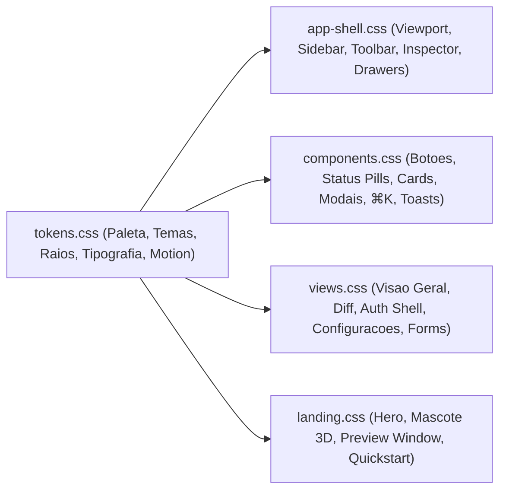
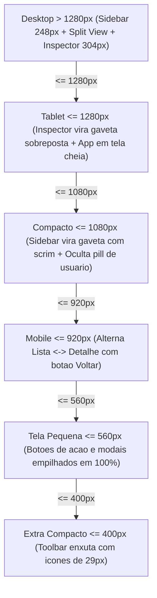

# Design System — Sentinel-MCP ("Botanical Obsidian")

O **Sentinel-MCP** adota um Design System próprio, sem frameworks CSS externos e compatível com **Content Security Policy estrita** (`script-src 'self'`, sem scripts inline). A linguagem visual combina a fluidez tátil de interfaces desktop estilo macOS com uma paleta botânica profunda de alto contraste para leitura técnica e revisão arquitetural prolongada.

---

## 1. Arquitetura do Design System

Os estilos são modularizados em cinco camadas dentro de [`src/Sentinel.Api/wwwroot/css/`](../../src/Sentinel.Api/wwwroot/css/):

| Arquivo | Responsabilidade |
| --- | --- |
| [`tokens.css`](../../src/Sentinel.Api/wwwroot/css/tokens.css) | Tokens primitivos da marca, tokens semânticos `[data-theme="light"]` e `[data-theme="dark"]`, escalas de raio, fontes, curvas de movimento, foco acessível e `prefers-reduced-motion`. |
| [`app-shell.css`](../../src/Sentinel.Api/wwwroot/css/app-shell.css) | Casca responsiva do console `/review`: janela macOS, barra lateral esquerda retrátil (`«` / `»`), toolbar adaptativa, `split-view` lista/detalhe e gaveta direita (`#macos-inspector`). |
| [`components.css`](../../src/Sentinel.Api/wwwroot/css/components.css) | Átomos e moléculas de governança: listas de registros, chips copiáveis, `status-pill`, comparação lado a lado (`diff-card`), botões `.btn-macos*`, Command Palette (`⌘K`), modais com confirmação digitada e toasts. |
| [`views.css`](../../src/Sentinel.Api/wwwroot/css/views.css) | Layouts das telas internas (`Visão Geral`, `Conectar IAs`, `Linha do Tempo`, `Administração`, `Configurações`) e páginas de autenticação (`.auth-shell`, `.auth-card`, `.password-input-wrap`). |
| [`landing.css`](../../src/Sentinel.Api/wwwroot/css/landing.css) | Experiência pública em `/`: loader animado com mascote SVG, barra flutuante translúcida, janela interativa com profundidade e quickstart por cliente MCP. |

---

## 2. Paleta da Marca & Tokens Semânticos

### 2.1 Escala Primitiva ("Botanical Obsidian")

| Token | Hex | Aplicação |
| --- | --- | --- |
| `--brand-black-green` | `#051F20` | Texto primário invertido sobre ação clara (`dark mode`) e sombras profundas |
| `--brand-forest-deep` | `#0B2B26` | Base de gradiente e sombras orgânicas no tema claro |
| `--brand-structural` | `#163832` | Hover de ação primária no tema claro e superfícies estruturais |
| `--brand-interaction` | `#235347` | Cor de ação primária e foco estrutural no tema claro |
| `--brand-sage` | `#8EB69B` | Cor de ação primária no tema escuro, bordas de foco e acento técnico |
| `--brand-mint` | `#DAF1DE` | Texto de código em terminais escuros (`--code-fg`) e hover luminoso |
| `--brand-lime` | `#C8F578` | Destaque de energia/progresso na barra de inicialização |

### 2.2 Superfícies & Contraste (Light vs Dark)

O tema é resolvido antes da primeira pintura por [`theme-boot.js`](../../src/Sentinel.Api/wwwroot/js/theme-boot.js) evitando *flash of unstyled content* (FOUC), e alternado em tempo real via atributo `data-theme="dark" | "light"` no `<html>`.

| Camada | `[data-theme="dark"]` | `[data-theme="light"]` | Papel na hierarquia |
| --- | --- | --- | --- |
| `--bg-canvas` | `#0D1411` | `#EEF2ED` | Fundo externo atrás da janela e páginas `/auth/*` |
| `--bg-window` | `#131C18` | `#FAFDF9` | Superfície principal do workspace, formulários e cards de auth |
| `--bg-sidebar` | `#16221C` | `#E6EDE6` | Barra lateral esquerda e agrupamentos de navegação |
| `--bg-surface-secondary` | `#1B2721` | `#F1F5F0` | Cards, `panel-card`, inspetor técnico, linhas de evidência |
| `--bg-selection` | `#253E32` | `#DCE9DD` | Item ativo na navegação, card selecionado na lista |
| `--text-primary` | `#E7F0E7` | `#142B23` | Títulos, labels principais e corpo de documentos |
| `--text-secondary` | `#9DB0A3` | `#53665C` | Descrições, metadados e timestamps |
| `--text-tertiary` | `#6C8376` | `#7D9185` | Rótulos de seção em caixa alta e placeholders |
| `--code-surface` | `#0B120E` | `#0B120E` | Terminal consistente para snippets Codex/Claude/Cursor/JSON |

### 2.3 Estados de Governança (`status-pill`)

| Estado de Domínio | Classe | Token de Fundo | Token de Texto | Uso |
| --- | --- | --- | --- | --- |
| `active` | `.active-state` | `--status-success-bg` | `--status-success` | Decisão vigente consolidada, integridade verificada, conta ativa |
| `proposed` | `.proposed-state` | `--status-warning-bg` | `--status-warning` | Proposta aguardando revisão humana ou escrita MCP |
| `reported` | `.reported-state` | `--bg-surface-secondary` | `--text-secondary` | Incidente reportado, decisão substituída ou metadado neutro |
| `rejected` | `.rejected-state` | `--status-danger-bg` | `--status-danger` | Proposta rejeitada, falha de integridade ou ação destrutiva |
| `info` | `.info-state` | `--status-info-bg` | `--status-info` | Recursos informativos e descoberta guiada MCP |

---

## 3. Tipografia, Raios & Movimento

- **Fontes**:
  - `--font-ui`: `-apple-system, BlinkMacSystemFont, "Segoe UI", Inter, system-ui, sans-serif` (leitura editorial limpa e sem dependência de CDNs externas).
  - `--font-mono`: `"Geist Mono", "IBM Plex Mono", ui-monospace, SFMono-Regular, Menlo, monospace` (UUIDs, slugs, hashes SHA-256, snippets e `stream_version`).
  - Números tabulares (`font-variant-numeric: tabular-nums`) aplicados em contadores e cards métricos.
- **Escala de Raios**: `--radius-xs` (`6px`), `--radius-sm` (`8px`), `--radius-md` (`12px`), `--radius-lg` (`16px`), `--radius-xl` (`20px`), `--radius-2xl` (`24px`), `--radius-pill` (`9999px`).
- **Motion**: curva desacelerada `cubic-bezier(0.16, 1, 0.3, 1)` em `--motion-fast` (`120ms`), `--motion-base` (`200ms`) e `--motion-sheet` (`260ms`), respeitando automaticamente `@media (prefers-reduced-motion: reduce)`.
- **Acessibilidade**: anel global `*:focus-visible { outline: 2px solid var(--border-focus); outline-offset: 2px; }`, navegação por teclado em itens `role="button"` (`Enter`/`Space`), `Esc` fecha modais/drawers e botões de alternância expõem `aria-expanded` / `aria-pressed`.

---

## 4. Layout Adaptativo & Breakpoints

O console `/review` se adapta progressivamente de uma estação de trabalho de 3 colunas até celulares de 360px sem perda de função nem rolagem horizontal:

---

## 5. Catálogo de Componentes & Padrões de UX

1. **Navegação Retrátil (`«` / `» Menu`)**: A barra lateral nunca fecha de forma irreversível; o botão na toolbar alterna dinamicamente entre `« Menu` (recolher) e `» Menu` (expandir) via [`app.js`](../../src/Sentinel.Api/wwwroot/js/app.js) e [`icons.js`](../../src/Sentinel.Api/wwwroot/js/icons.js).
2. **Comparação Lado a Lado (`.comparison-diff-grid`)**: Ao revisar uma atualização de tópico existente, `.diff-card.current` (borda de atenção) e `.diff-card.proposed` (borda primária) exibem a versão vigente e a proposta simultaneamente.
3. **Campos de Senha com Visualização e Confirmação**: `.password-input-wrap` + `.password-toggle-btn` permitem alternar `password`/`text` com ícone SVG (`eye` / `eyeOff`), usados em `/auth/setup`, `/auth/login`, criação de usuários web e campo de `ADMIN_API_KEY`. Em `/auth/setup`, `#setup-password-match` valida coincidência em tempo real via [`auth-setup.js`](../../src/Sentinel.Api/wwwroot/js/auth-setup.js).
4. **Confirmação Explícita para Ações Destrutivas**: Exclusão de projeto, revogação de chave `snt_...` e remoção de vínculo usam `#modal-dialog` com `#modal-confirm-phrase-wrap` — o botão destrutivo só habilita após digitar exatamente o identificador alvo (`slug`, nome da chave ou `subject`).
5. **Painel de Credenciais MCP (`.token-reveal-box` + `.code-panel`)**: Exibe o token `snt_...` em claro uma única vez no topo da tela e preenche automaticamente os blocos prontos de **OpenAI Codex**, **Claude Code**, **Cursor IDE**, **Gemini CLI**, **VS Code** e **HTTP/curl**.
6. **Segurança Visual por Padrão**:
   - Todo dado vindo da API passa por `escapeHtml()` antes de entrar no DOM.
   - Somente URLs `https://` absolutas viram `<a href target="_blank" rel="noopener noreferrer">`; demais formatos são renderizados como texto inerte em `.evidence-text-row`.
   - Zero bibliotecas externas ou CDNs: SVG inline controlado em [`icons.js`](../../src/Sentinel.Api/wwwroot/js/icons.js).
