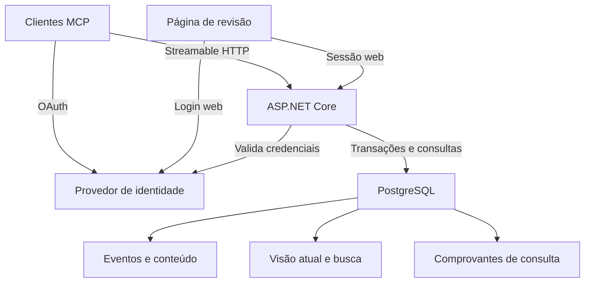

# Sentinel-MCP — Documento de Design de Software

| Campo | Definição |
| --- | --- |
| Versão | 0.1, proposta para revisão |
| Objetivo | Especificar o primeiro piloto e orientar a implementação |
| Usuário inicial | Equipe de engenharia que usa agentes de IA para desenvolvimento, revisão e análise de incidentes |
| Arquitetura proposta | ASP.NET Core sobre .NET 9 LTS, SDK oficial MCP, PostgreSQL 16+ e provedor OAuth compatível com MCP |
| Padrões arquiteturais | Event Sourcing, CQRS, Row-Level Security (RLS), Streamable HTTP e Organic macOS UI |

## 1. Problema e resultado esperado

Um agente abre um PR propondo uma abordagem já descartada. Outro analisa um incidente sem conhecer a correção aplicada em um caso anterior. O conhecimento existe em PRs, ADRs e RCAs, mas cada agente precisa descobrir quais registros deve consultar e se continuam válidos.

O Sentinel disponibiliza, via MCP, decisões aprovadas e incidentes reportados. Cada resultado informa a origem, a versão, o estado e as evidências. Um mantenedor pode substituir uma decisão e reconstruir o estado anterior. Um comprovante de consulta permite identificar as versões que o servidor preparou para devolver, mesmo após uma substituição.

**Fluxo do piloto.** Um agente registra um incidente fictício de duplicação de cobrança, com o RCA e o PR de correção como evidências. Em seguida, propõe uma decisão sobre idempotência. Um mantenedor aprova a proposta. Outro agente consulta a decisão, recupera a evidência e referencia o resultado em uma revisão. Depois de uma substituição, a mesma consulta devolve a decisão vigente. O comprovante anterior conserva a versão selecionada na primeira consulta.

**Limites do MVP.** Um provedor de identidade, dois clientes MCP de referência, isolamento por workspace, projetos dentro de um workspace, busca textual e uma página de aprovação. O piloto usa dados fictícios ou exemplos públicos autorizados. Busca vetorial, ingestão automática de GitHub ou Azure DevOps, acesso de agentes em background sem usuário, integração com outros hosts, consolidação automática e deploy na borda pertencem a fases posteriores.

## 2. Princípios de Engenharia do Sentinel

| Princípio de Projeto | Aplicação no Sentinel |
| --- | --- |
| Armazenamento Imutável | PostgreSQL guarda os eventos e o conteúdo referenciado. A visão atual e a busca são reconstruíveis deterministicamente a partir desse histórico. |
| Serialização e Concorrência | A transação serializa alterações do mesmo tópico no banco. Versão esperada evita sobrescrita e chave de idempotência resolve repetição após timeout. Tópicos distintos avançam em paralelo. |
| Projeções e Reconciliação | A projeção textual entra na transação atômica. Se a busca semântica entrar, um worker dedicado reconcilia divergências e versionamento por documento. |
| Interface Única de Consulta | `query_context` mantém uma interface única e previsível. O ranking de busca textual e identificadores exatos pode evoluir sem quebrar contratos de clientes. |
| Rastreabilidade e Repetibilidade | Cada ADR declara a propriedade esperada e como verificá-la. CI roda os testes contra banco real e `AGENTS.md` padroniza execução repetível. |
| Governança com Separação de Acesso | O Sentinel valida, em cada operação, a identidade, o escopo do cliente e o vínculo da pessoa com o workspace, impedindo aprovações automáticas por agentes. |

## 3. Arquitetura do MVP

Uma aplicação ASP.NET Core hospeda o endpoint MCP, os casos de uso e a página de revisão. PostgreSQL centraliza transações, controle de acesso às linhas e busca. O provedor de identidade fica separado da aplicação. Em desenvolvimento, Docker Compose sobe a aplicação e o banco. A validação OAuth ponta a ponta usa o provedor configurado para o ambiente de teste.

| Módulo | Responsabilidade |
| --- | --- |
| `Mcp` | Receber chamadas, validar schemas, aplicar escopos e traduzir resultados ao protocolo. |
| `Decisions` | Propor, aprovar, rejeitar, substituir, restaurar e consultar a linha do tempo de decisões. |
| `Incidents` | Registrar incidentes como relatos com evidências e permitir consulta explícita. |
| `Context` | Buscar no workspace, filtrar por vigência e registrar as versões selecionadas. |
| `Identity` | Resolver identidades autenticadas, vínculos, papéis e permissões da sessão web. |
| `Persistence` | Transações, migrações, políticas RLS, consultas, idempotência e reconstrução das projeções. |

A lógica de domínio depende de contratos internos de persistência. MCP e a página web chamam os mesmos casos de uso, cada um sob sua política de autorização. Comece com SQL explícito via Npgsql para escrita e busca, migrações SQL versionadas e poucos projetos .NET. Use um container de PostgreSQL nos testes de integração.

## 4. Domínio, dados e invariantes

**Workspace** é a fronteira de acesso. **Projeto** organiza conteúdo dentro do workspace. O MVP concede acesso a todos os projetos do workspace para um membro autorizado. **Tópico** é a unidade de concorrência de decisões, com identificador próprio e chave curta por projeto, como `payment-idempotency`.

### 4.1 Ciclo de vida

- Um tópico pode ter uma decisão vigente e, em paralelo, uma proposta pendente. A primeira proposta usa `expectedVersion = 0`. Para as demais, o cliente informa a versão atual do tópico.
- A aprovação promove a proposta a vigente e, quando existe uma decisão vigente, marca a anterior como substituída. O mesmo evento de aprovação descreve essa transição atômica. Rejeitar encerra a proposta e conserva a decisão vigente.
- Se uma proposta precisar ser corrigida antes da aprovação, o mantenedor a rejeita e o agente envia outra. A restauração cria uma nova proposta referenciando uma versão anterior. A nova aprovação preserva o histórico das duas decisões.
- Incidentes entram como `reported` e podem fornecer evidência para uma proposta. Apenas a aprovação explícita transforma uma proposta em decisão vigente. O registro de incidente tem um evento inicial no MVP.

### 4.2 Armazenamento

| Estrutura | Conteúdo e restrições |
| --- | --- |
| `workspaces`, `memberships`, `projects` | Identificadores do workspace e projeto. Vínculo único por workspace e identidade (`issuer`, `subject`), com papel e situação ativa. |
| `decision_topics`, `incident_streams` | Identidade dos registros e versão corrente do fluxo. Unicidade defensiva em `(workspace_id, project_id, topic_key)`. O tópico persistido mantém a versão usada no controle de concorrência. |
| `memory_events` | Envelope com `event_id`, `workspace_id`, `project_id`, `stream_id`, `stream_version`, `type`, `schema_version`, `recorded_at`, autor autenticado, `client_id` quando comprovado e referências a conteúdo e eventos. Chave única em `(workspace_id, stream_id, stream_version)`. |
| `memory_payloads` | Título, resumo, justificativa, identificadores técnicos, vínculos com incidentes e evidências. Uma revisão tem seu próprio conteúdo. Evidência tem tipo, rótulo e URL HTTPS. O servidor armazena a referência e evita acessar a URL durante a chamada. |
| `decision_current`, `incident_current` | Projeções com versões do fluxo e dos registros, estado, vínculos para evidências e colunas para recuperação textual. O índice usa o mesmo banco. |
| `command_receipts` | Chave única em `(workspace_id, principal_id, operation, idempotency_key)`, mais impressão digital dos argumentos validados e resultado mínimo. Janela inicial de 30 dias, declarada ao cliente. |
| `context_receipts`, `context_receipt_items` | Autor da consulta, cliente comprovado, projeto, instante, modo de busca e lista ordenada de IDs e versões selecionados. Sem armazenar pergunta, resumo ou prompt. Janela inicial de 30 dias. |

## 5. Contrato MCP e revisão

**Endpoint.** `/mcp`, Streamable HTTP via SDK oficial, em modo sem sessão persistente no servidor para o piloto. O SDK negocia a versão do protocolo. Tools usam `inputSchema` e `outputSchema`. Clientes que precisarem recebem também representação textual compatível. A página de revisão roda em rota web separada.

| Operação | Entrada principal | Resultado e permissões |
| --- | --- | --- |
| `propose_decision` | `workspaceId`, `projectId`, `topicKey`, `expectedVersion`, `title`, `summary`, `rationale`, `technicalKeys[]` opcional, `relatedIncidentIds[]` opcional, `evidence[]`, `idempotencyKey`. | `topicId`, `proposalId`, `streamVersion`, `status: proposed`. `write:decision` e papel Contributor ou Maintainer. |
| `log_incident` | `workspaceId`, `projectId`, `title`, `summary`, `occurredAt` opcional, `technicalKeys[]`, `evidence[]`, `idempotencyKey`. | `incidentId`, `streamVersion: 1`, `status: reported`. `write:incident` e papel Contributor ou Maintainer. |
| `query_context` | `workspaceId`, `projectId`, `query`, `kind` com padrão `decision`, `limit` entre 1 e 20. | `queryId`, `matchStatus`, `searchMode`, `items[]` com IDs, versões, estado, resumo e evidências. `read:memory` e papel Reader ou superior. |
| `get_timeline` | `workspaceId`, `projectId`, `kind`, `streamId`, `atVersion` opcional, `beforeVersion` opcional e `limit` entre 1 e 50. | Estado reconstruído em `atVersion`, eventos paginados e `nextBeforeVersion` quando aplicável. Sem `atVersion`, usa a versão atual na transação. `read:memory` e papel Reader ou superior. |
| `get_context_receipt` | `workspaceId`, `projectId`, `queryId`. | Lista ordenada de referências selecionadas e metadados de consulta. `read:memory`, vínculo ativo e identidade autora do comprovante. |
| Revisão na web | Workspace, projeto, tópico, proposta, ação, `expectedVersion`, motivo para rejeição e chave de idempotência do formulário. | Aprovação ou rejeição auditada, mediante sessão web, papel Maintainer e confirmação explícita. A restauração usa a mesma página para gerar uma proposta e exige aprovação posterior. |

## 6. Fluxos e garantias de consistência

### 6.1 Escrita de uma proposta
1. Transação configura contexto de workspace e confirma vínculo com a identidade autenticada.
2. Restrição única de command_receipt serializa chave de idempotência. Se comando já concluído com mesmos argumentos, devolve resultado original. Se argumentos diferentes, `IDEMPOTENCY_KEY_REUSED`.
3. Para tópico existente, trava e compara versão (`expectedVersion`).
4. Evento, payload, projeção e recibo entram no mesmo commit atômico.

### 6.2 Busca e comprovante
1. Consulta textual com `tsvector`, índice GIN e ranking textual determinístico. Prioridade a correspondências exatas em identificadores técnicos normalizados.
2. Restringe candidatos por workspace, projeto, tipo e estado (`active` para decisões, `reported` para incidentes).
3. Na mesma transação, seleciona e grava o comprovante ordenado.
4. Reconstrução de projeções: agrupando eventos por stream_id, reaplicando o redutor determinístico.

## 7. Segurança e privacidade
- OAuth PKCE S256 e verificação de emissor, audiência, expiração e escopos.
- Row Level Security (RLS) no PostgreSQL com `app.current_workspace_id`.
- Separação entre credencial MCP e sessão web de revisão com CSRF e papel Maintainer.
- Sanitização de inputs, proteção contra prompt injection, logs sem segredos/payloads.

## 8. Verificação e operação (Critérios de Aceite)
- AC-01 Interoperabilidade
- AC-02 Concorrência no mesmo tópico
- AC-03 Independência entre tópicos
- AC-04 Idempotência e commit incerto
- AC-05 Isolamento e revisão
- AC-06 Vigência e histórico
- AC-07 Qualidade e latência
- AC-08 Recuperação e reprodução
