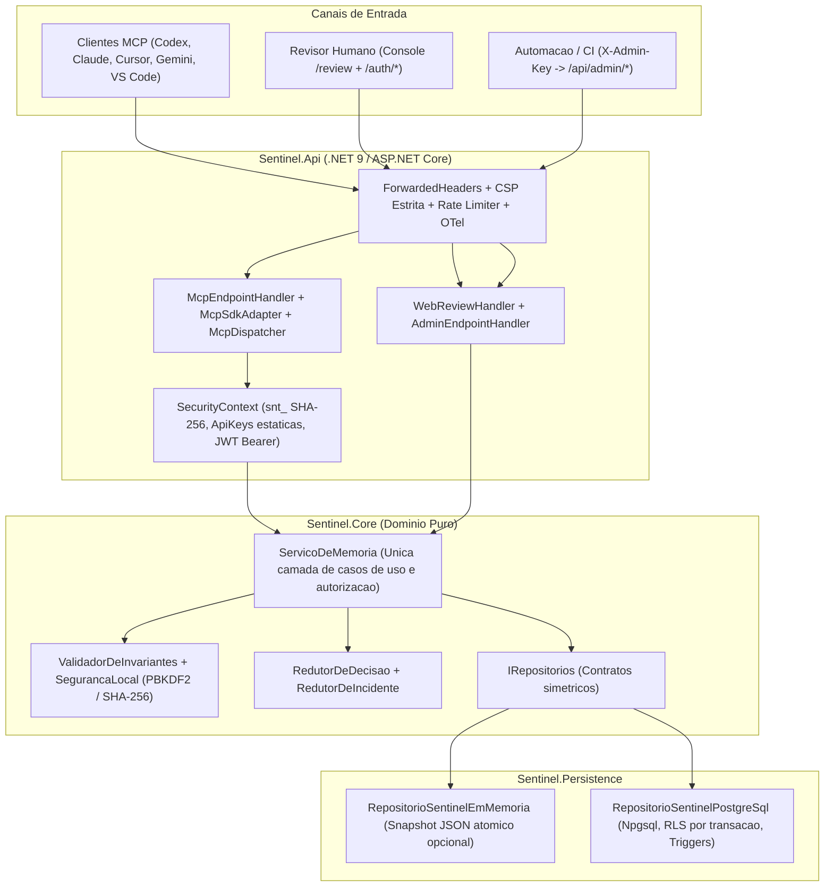
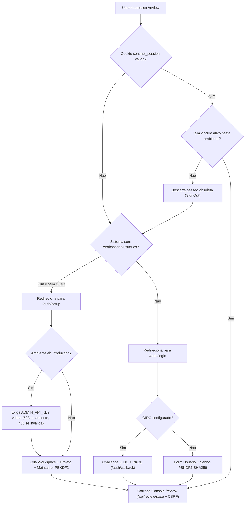
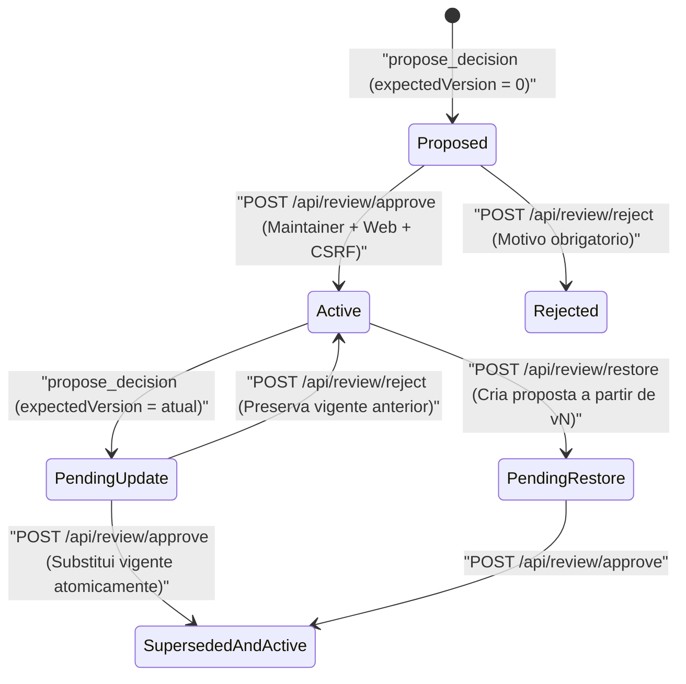
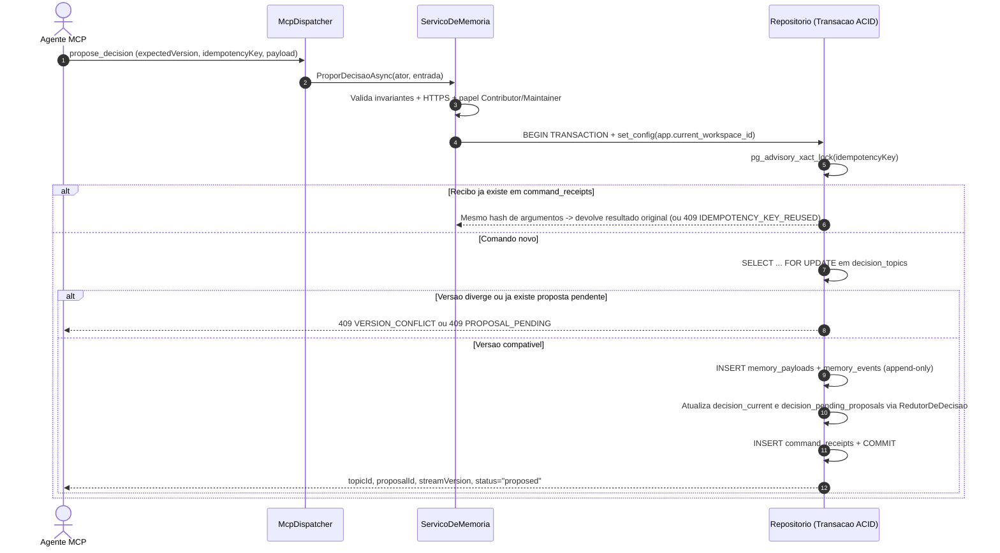
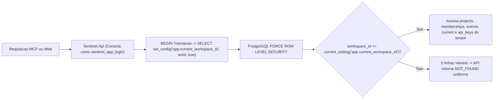

# Arquitetura, Módulos e Fluxogramas — Sentinel-MCP

Este documento apresenta a arquitetura modular e os principais fluxos operacionais do **Sentinel-MCP**, válidos tanto no modo **local individual** (`Development` com `data/sentinel-local.json`) quanto em **produção organizacional** (`PostgreSQL` + `FORCE ROW LEVEL SECURITY`).

---

## 1. Visão em Camadas da Solução

| Projeto / Pasta | Responsabilidade |
| --- | --- |
| `src/Sentinel.Core` | Domínio puro sem dependência de banco ou HTTP: `ServicoDeMemoria`, `ValidadorDeInvariantes`, `SegurancaLocal` (PBKDF2-SHA256 210 mil iterações e geração de chaves `snt_`), `RedutorDeDecisao`, `RedutorDeIncidente`, `IRepositorios` e exceções tipadas. |
| `src/Sentinel.Persistence` | Persistência simétrica sob os mesmos contratos: `RepositorioSentinelEmMemoria` (dev/local com gravação atômica em `Sentinel:LocalDataFile`) e `RepositorioSentinelPostgreSql` (Npgsql, SQL parametrizado, RLS por transação e migrador com `pg_advisory_lock`). |
| `src/Sentinel.Api` | Servidor HTTP + modo `--stdio`: `Program.cs` (pipeline, DataProtection, ForwardedHeaders, RateLimiter, OTel), `/auth/setup`, `/auth/login`, `/review`, `/mcp`, `/mcp/sse`, `/api/admin/*` e console web com [Design System](../design/DESIGN_SYSTEM.md). |
| `db/migrations` | Migrações `001` a `006`: schema append-only, RLS + `FORCE ROW LEVEL SECURITY`, `tsvector`/GIN, integridade SHA-256, `local_users`, `agent_api_keys` e grants mínimos para `sentinel_app`. |
| `tests/` | `Sentinel.UnitTests` (44 testes), `Sentinel.ContractTests` (27 testes) e `Sentinel.IntegrationTests` (AC-01 a AC-08, `AdminApiTests` e `FluxoSemMocksTests` em InMemory e PostgreSQL Testcontainers). |

---

## 2. Fluxo de Autenticação, Onboarding e Separação de Canais

Nenhuma credencial de demonstração vem ativada por padrão (`AllowMockTokens=false`, `EnableDevLogin=false`, `SeedDemoData=false`).

---

## 3. Ciclo de Vida de Estados de uma Decisão

Um tópico de decisão pode manter **uma decisão vigente (`active`)** e **no máximo uma proposta pendente (`proposed`)** simultaneamente sem perder o histórico de versões.

---

## 4. Concorrência Otimista, Idempotência e Comprovante SHA-256

---

## 5. Isolamento Multi-Tenant com PostgreSQL `FORCE ROW LEVEL SECURITY`

Em produção, a API nunca conecta como superusuário: `Program.cs` recusa iniciar se o login em `ConnectionStrings:Database` possuir `rolsuper` ou `rolbypassrls`.

---

## 6. Catálogo Completo MCP & Administração

### Ferramentas, Resources e Prompts MCP

| Tipo | Identificador | Escopo / Função |
| --- | --- | --- |
| Tool | `list_workspaces` | `read:memory` — Lista workspaces, papel e projetos acessíveis à credencial. |
| Tool | `query_context` | `read:memory` — Busca lexical determinística e gera comprovante `queryId` SHA-256. |
| Tool | `get_timeline` | `read:memory` — Lista eventos paginados (`beforeVersion`) e reconstitui estado (`atVersion`). |
| Tool | `get_context_receipt` | `read:memory` — Verifica integridade SHA-256 do comprovante (autor ou `Maintainer`). |
| Tool | `propose_decision` | `write:decision` — Submete proposta com `expectedVersion` e `idempotencyKey`. |
| Tool | `log_incident` | `write:incident` — Registra incidente append-only com `occurredAt` e evidências HTTPS. |
| Resource | `sentinel://workspaces` | Catálogo JSON de workspaces/projetos da identidade autenticada. |
| Resource | `sentinel://guide` | Guia operacional Markdown para agentes MCP. |
| Template | `sentinel://workspaces/{workspaceId}/projects/{projectId}/decisions` | Decisões vigentes ativas de um projeto. |
| Template | `sentinel://workspaces/{workspaceId}/projects/{projectId}/incidents` | Incidentes reportados de um projeto. |
| Prompt | `consult_context_before_change` | Roteiro de descoberta e consulta antes de modificar código. |
| Prompt | `propose_architecture_decision` | Roteiro de proposta arquitetural versionada. |
| Prompt | `report_incident_rca` | Roteiro de registro de incidente e RCA. |

### Rotas Administrativas (`/api/admin/*`) e Revisão (`/api/review/*`)

- **Workspaces & Projetos**: `GET/POST /api/admin/workspaces`, `GET/PUT /api/admin/workspaces/{workspaceId}`, `GET/POST /api/admin/workspaces/{workspaceId}/projects`, `DELETE .../projects/{projectId}` (`409` se houver histórico).
- **Credenciais & Vínculos**: `GET/POST/DELETE .../api-keys`, `GET/POST .../users`, `GET/POST/DELETE .../memberships`.
- **Governança Humana**: `GET /api/review/state`, `GET /api/review/timeline`, `GET /api/review/receipt`, `POST /api/review/approve`, `/reject`, `/restore` (exclusivos de sessão web `Maintainer` com `X-CSRF-Token`).
